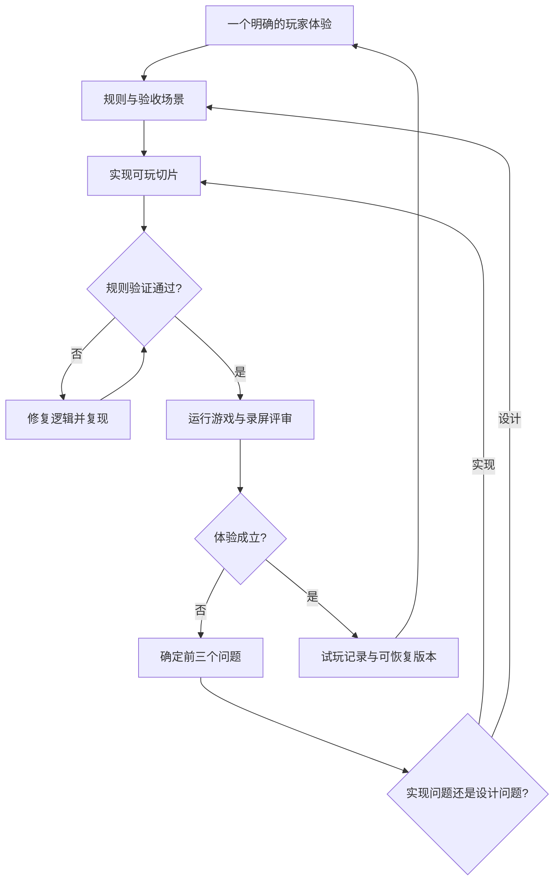

# 修仙像素沙盒：Vibe Coding 工作流

日期：2026-10-27。配套设计见 ../xiuxian_engine/v1/s1_final/design.md。第一轮观察窗口已实现，实际启动与验证结果见 README.md、notes.md；下文保留后续迭代可复用的工作流。

## 分工

你负责产品目标、审美取舍和真实试玩。策划角色产出规则、分镜式交互场景和验收条件；实现角色把它做成可运行版本；评审角色检查行为、画面和证据。角色可在同一聊天中依次执行，不要求同时启动多个代理。

可以尝试 Opus 5.5 做创意提案与设计评审，Codex 做 Godot 实现与自动验证。这是待检验的分工，不是认定某个模型在本游戏上必然更强。没有另一模型时，也可以先后切换职责。

## 最少的项目记忆

| 文件 | 用途 |
| --- | --- |
| ../xiuxian_engine/v1/s1_final/design.md | 玩家体验、范围与技术边界；改变方向时才更新 |
| ../xiuxian_engine/v1/s1_final/plan.md | 开发时创建，只细化当前里程碑的具体任务 |
| notes.md | 开发时创建，记录当前可玩入口、真实结果、问题与下一步 |
| evidence/ | 开发时创建，保存固定场景的截图、短录屏与性能记录 |

第一版不要先建设庞大的 Agent 平台、知识库或文档体系。项目记忆必须帮助下一轮工作恢复现场。

## 一轮开发

1. 你提出一个可观察的体验，例如“点化灵气泉后，有资质的小人会迁来修炼”。
2. 策划写明触发、行为、画面反馈、失败情况和验收场景，不直接扩展完整修仙系统。
3. 实现者阅读相关代码，把工作拆成当前可验证的小任务，完成一个可玩切片。
4. 用固定种子验证模拟规则，运行游戏并记录同一场景的画面；交互必须在运行时测试。
5. 评审者对照目标指出最影响体验的三个问题，每条都标明证据、影响与修改方向。
6. 修复必要问题并重走受影响场景；试玩成立后保存版本，再进入下一条体验。



有新崩溃或行为回归时，先记录可复现输入并恢复最近可玩状态；失败变更保持可审查，不用覆盖整个项目来重做。

## 给策划角色的提示词

```text
阅读 ../xiuxian_engine/v1/s1_final/design.md，围绕当前里程碑提出一个可玩的修仙沙盒切片。
本轮目标：[写一个玩家能观察到的体验]。
输出：玩家操作、世界规则、人物行为、视觉反馈、3 个验收场景。
说明这些规则如何产生故事，哪里可能无聊或难以理解。
如有设计分歧，给两个具体方案及取舍；不要扩展到后续里程碑。
本轮仅产出设计，不改代码。
```

## 给实现角色的提示词

```text
阅读 ../xiuxian_engine/v1/s1_final/design.md、当前 ../xiuxian_engine/v1/s1_final/plan.md 与 notes.md 中相关内容；不存在的文件不要假定存在。
本轮只实现：[当前切片]。
以工程实际锁定的 Godot 版本为准；不要静默更换引擎或升级依赖。
先检查相关入口与现有改动，再细化当前任务。
世界规则与显示逻辑分开；自主行为和玩家控制使用同一指令入口。
为重要规则与已复现错误写有区分力的检查；不为纯视觉微调堆砌测试。
实现后实际运行并验证验收场景，记录固定种子和模拟时刻。
报告可玩入口、操作方式、验证证据、遗留问题。
缺少运行环境或不能采集画面时明确说明；不能把静态检查当作试玩通过。
```

## 给评审角色的提示词

```text
你负责本轮的游戏体验评审，先阅读本轮目标与验收场景。
结合真实运行的截图、录屏、事件与模拟状态判断，不从代码推测成品效果。
分别检查：行为是否有因果，画面是否清楚，等待是否值得，操作是否顺手。
找出最影响目标的三个问题，逐条给证据、玩家影响和可执行修改方向。
说明哪些已经核实、哪些仍是猜测；没有画面时标记未验证。
不直接给自己打“高级感 9 分”，不以增加系统和特效替代解决当前问题。
```

## 三类验收各司其职

- 规则验收：状态、资源、境界、随机数、事件和存档是否正确。可无画面运行。
- 表现验收：像素比例、镜头、动作、特效、信息层级和连续播放效果。需要实际画面。
- 玩法验收：你是否愿意继续观察，干预是否有后果，人物是否值得关注。需要真人试玩。

## 自动化的接入顺序

先锁定 Godot 版本与导出模板，再接命令行检查与无画面模拟验证，随后接固定场景截图/录屏和 Windows 导出冒烟检查。GUI 测试必须使用真实图形会话，headless 不能证明画面和鼠标交互正常。

Godot 支持命令行与 headless 模式；测试入口、场景采集和性能报告仍需项目自己实现。具体参数以所锁定版本的 --help 和官方文档为准。

## 每次收尾的记录模板

```text
当前版本 / Godot 版本：
本轮玩家体验：
启动入口与操作：
固定场景：地图种子、人口、模拟时刻、速度、指令序列。
规则验证：命令、结果、未覆盖内容。
视觉证据：截图与短录屏路径；实际检查的状态。
性能：硬件、分辨率、构建类型、地图/人口、帧时间与模拟更新耗时。
试玩反馈：真实观察与设计假设分开记录。
已知问题：
下一步最小任务：
```

## 建议从这一轮开始

只做一块可缩放地图、30 名自主行动小人、一个可放置的灵气泉、一个可点击人物面板。先看清“谁在做什么”，再完成修炼与突破的因果链。

先用统一尺寸、配色和动作的临时像素素材。视觉样片确定后再制作成套资源；不要提前生成上百张比例与风格不一致的素材。

## 来源

- Godot 命令行：https://docs.godotengine.org/en/stable/tutorials/editor/command_line_tutorial.html
- Godot Windows 导出：https://docs.godotengine.org/en/stable/tutorials/export/exporting_for_windows.html
